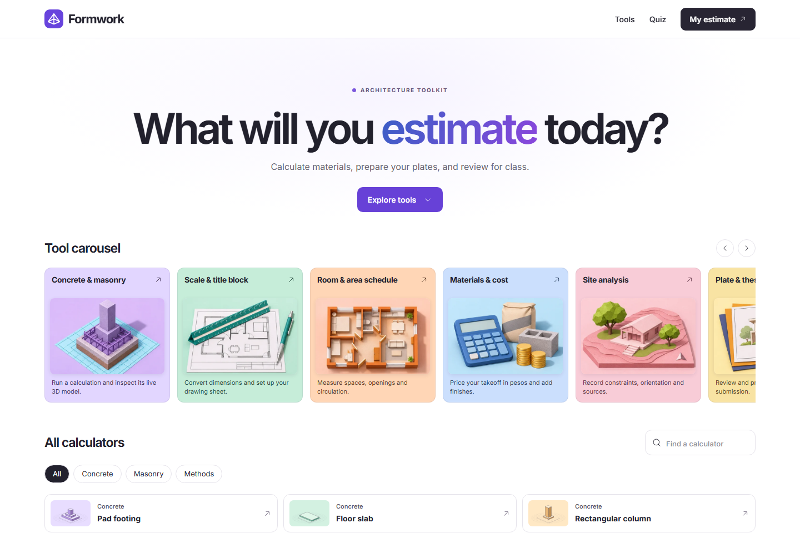
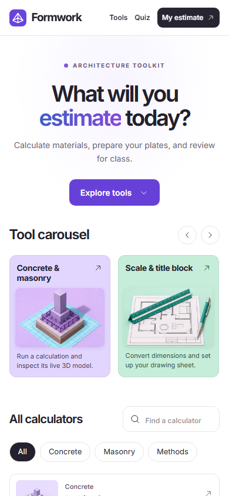

# Formwork

**An architecture student’s toolkit for estimates, design planning, and study.**

Formwork brings concrete and masonry calculations together with visual models, room schedules, cost estimates, site analysis, and a quiz reviewer. It is designed for students preparing architecture coursework and preliminary project submissions.

## Screenshots

| Desktop | Mobile |
| --- | --- |
|  |  |

## Features

- **Concrete and masonry estimates** — calculate materials for footings, beams, slabs, walls, stairs, columns, plaster, and more.
- **Interactive 3D previews** — rotate and zoom models that respond to your dimensions. Some previews use illustrative geometry where the calculation does not specify a complete shape.
- **Project summary and costs** — collect takeoffs, enter supplier prices in Philippine pesos, and add finishes.
- **Architecture studio** — convert drawing scales, prepare a title block, schedule room areas, and record site observations.
- **Plate and thesis pack** — combine project details, calculations, costs, site notes, and a 3D view in an A3 print layout. Use the browser print dialog to save a PDF.
- **Quiz reviewer** — paste or upload questions, or copy a prompt for ChatGPT or Claude and import the generated quiz.

Estimates, studio drafts, and quiz progress are stored in the browser on the current device. Clearing site data removes them.

## Getting started

Requirements: Node.js 22 or newer and npm.

```bash
npm install
npm run dev
```

Open [http://localhost:3000](http://localhost:3000).

```bash
npm run lint
npm run typecheck
npm run build
```

## Built with

Next.js App Router, React, TypeScript, Tailwind CSS, shadcn/ui, Hugeicons, and Inter.

## Using estimates

Formwork reproduces formulas and reference factors from the supplied concrete estimate workbook. Check the inputs and applicable project specifications before using a result for construction or purchasing. Consult a qualified professional where appropriate.
